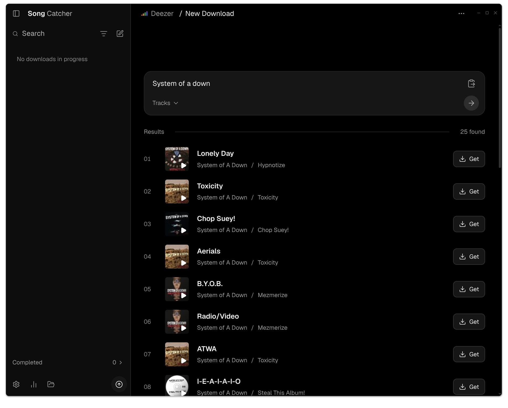

# Song Catcher

A self-hosted app for downloading music from Deezer and YouTube. Run it as a web app on your own server or as a
desktop app on Linux, Windows and macOS.



## Features

- Search Deezer for tracks, albums and artists, and preview tracks before downloading.
- Download tracks, albums and Deezer playlists, as MP3 or FLAC, tagged and with cover art.
- Download audio from YouTube, one video or a whole playlist.
- Follow downloads in a live queue and browse the downloaded files.
- Optional MPD integration, proxy support and HTTP Basic auth.

## Desktop app

The desktop app needs no Node.js, no `.env` file and no terminal. The backend runs inside the app, and `yt-dlp` and
`ffmpeg` are bundled.

```bash
npm install
npm run desktop        # build everything and start the app from source
npm run desktop:dist   # build an installer for the platform you are on, into desktop/release/
```

- The first launch asks for your [ARL cookie](#getting-your-arl-cookie). After that the settings open from the
  gear in the sidebar or **File → Settings…** (`Ctrl+,`); saving a new ARL or download setting asks to reload
  the app, which restarts the download service.
- Downloads go to `Music/Song Catcher` in your home folder unless you choose another folder.
- **File → Update yt-dlp** downloads the latest yt-dlp when YouTube downloads start failing.
- FLAC needs `metaflac` (from the `flac` package) installed on the computer.
- The installers are not code-signed, so Windows SmartScreen and macOS Gatekeeper warn on first launch.

## Web app

Requirements: Node.js 22.9 or newer, `ffmpeg` and `yt-dlp` for YouTube downloads, and `metaflac` (from the `flac`
package) for FLAC.

```bash
git clone https://github.com/djuricmarko/song-catcher.git
cd song-catcher

npm install
cp .env.example .env   # then set DEEZER_COOKIE_ARL
npm run build
npm run start:server
```

Open <http://127.0.0.1:5000>.

On Linux, `scripts/install-desktop-entry.sh` adds Song Catcher to your application menu. Launching it starts the
server in the background and opens the UI in your browser. Run it with `--uninstall` to remove the entry.

### Docker

```bash
docker build -t song-catcher .

docker run --rm -p 5000:5000 \
  -v "$(pwd)/downloads:/mnt/deezer-downloader" \
  -e DEEZER_COOKIE_ARL=your_arl_cookie \
  song-catcher
```

The image includes `ffmpeg`, `flac` and `yt-dlp`. Downloads are stored in `/mnt/deezer-downloader`.

## Getting your ARL cookie

1. Log in to Deezer in a browser.
2. Open the browser developer tools.
3. Find the `arl` cookie for `deezer.com` under Storage → Cookies and copy its value.

The ARL works like a password. Never commit it, and do not expose the app to the internet without authentication:
set `DEEZER_AUTH_USER` and `DEEZER_AUTH_PASSWORD`, or put the app behind an authenticating reverse proxy.

## Configuration

The web app is configured with environment variables. [`.env.example`](.env.example) is a documented starting
point. The desktop app keeps these in its settings instead.

| Variable                      | Default                  | Description                                                               |
| ----------------------------- | ------------------------ | ------------------------------------------------------------------------- |
| `DEEZER_COOKIE_ARL`           | **required**             | Deezer ARL cookie.                                                        |
| `DEEZER_QUALITY`              | `mp3`                    | `mp3` or `flac`. Falls back to MP3 if the account has no lossless access. |
| `DEEZER_PROXY_URL`            | empty                    | Optional `https://`, `socks5://` or `socks5h://` proxy.                   |
| `DEEZER_HTTP_HOST`            | `127.0.0.1`              | HTTP listen address. Use `0.0.0.0` in Docker.                             |
| `DEEZER_HTTP_PORT`            | `5000`                   | HTTP listen port.                                                         |
| `DEEZER_URL_PREFIX`           | empty                    | Reverse-proxy path prefix, for example `/deezer`.                         |
| `DEEZER_AUTH_USER`            | empty                    | HTTP Basic auth user. Set with `DEEZER_AUTH_PASSWORD` to require a login. |
| `DEEZER_AUTH_PASSWORD`        | empty                    | HTTP Basic auth password. `/api/health` stays public for health checks.   |
| `DEEZER_WORKERS`              | `4`                      | Number of download workers (1–32).                                        |
| `DEEZER_TASK_HISTORY`         | `500`                    | Maximum number of finished tasks kept in the queue.                       |
| `DEEZER_DOWNLOAD_DIR`         | `/tmp/deezer-downloader` | Base download directory.                                                  |
| `DEEZER_SONGS_DIR`            | `${base}/songs`          | Track directory.                                                          |
| `DEEZER_ALBUMS_DIR`           | `${base}/albums`         | Album directory.                                                          |
| `DEEZER_PLAYLISTS_DIR`        | `${base}/playlists`      | Playlist directory.                                                       |
| `DEEZER_YOUTUBE_DIR`          | `${base}/youtube-dl`     | YouTube download directory.                                               |
| `DEEZER_YOUTUBE_PLAYLIST_MAX` | `500`                    | Maximum number of songs taken from one YouTube playlist (1–10000).        |
| `DEEZER_MPD_ENABLED`          | `false`                  | Enable MPD integration.                                                   |
| `DEEZER_MPD_HOST`             | `localhost`              | MPD host.                                                                 |
| `DEEZER_MPD_PORT`             | `6600`                   | MPD port.                                                                 |
| `DEEZER_MPD_MUSIC_DIR_ROOT`   | —                        | Required when MPD is enabled. All download directories must be inside it. |
| `DEEZER_YTDLP_PATH`           | `yt-dlp`                 | yt-dlp executable name or absolute path.                                  |
| `DEEZER_FFMPEG_PATH`          | `ffmpeg`                 | ffmpeg executable name or absolute path.                                  |
| `DEEZER_METAFLAC_PATH`        | `metaflac`               | metaflac executable name or absolute path.                                |
| `DEEZER_LOG_LEVEL`            | `info`                   | `fatal`, `error`, `warn`, `info`, `debug` or `trace`.                     |
| `DEEZER_LOG_FILE`             | empty                    | If set, logs are also written to this file and shown in the Logs dialog.  |
| `DEEZER_DEBUG_COMMAND`        | empty                    | Shell command whose output the Logs dialog shows instead of the log file. |

## Development

```bash
npm run dev:server   # backend with reload on change (port 5000)
npm run dev:web      # Vite with hot reload (http://localhost:5173)
npm test             # Vitest suites
npm run typecheck    # TypeScript checks
npm run lint         # ESLint (run a build first; it reads the shared types)
npm run format       # Prettier
```

The repository is an npm workspace: `shared/` holds the API types, `server/` the Fastify backend, `web/` the React
frontend and `desktop/` the Electron app. Tests use mocked Deezer responses and need no ARL.

## License

MIT. See [LICENSE](LICENSE).
